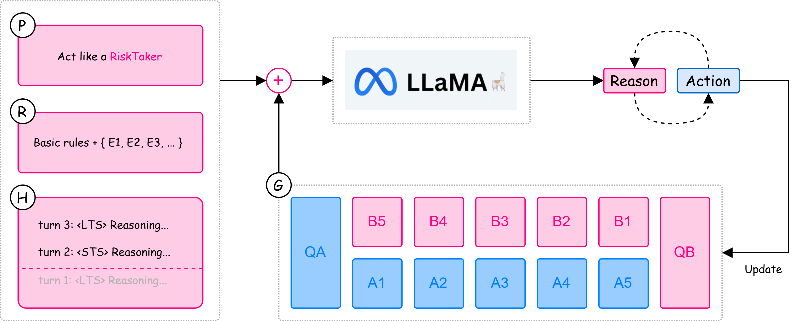
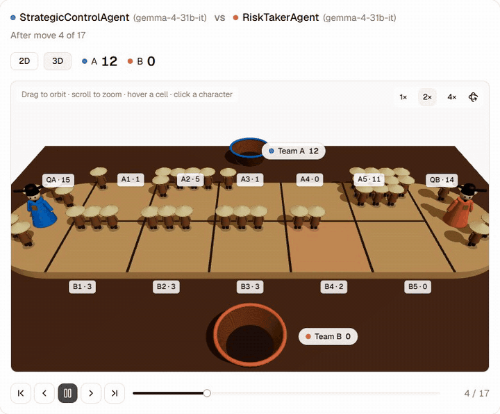
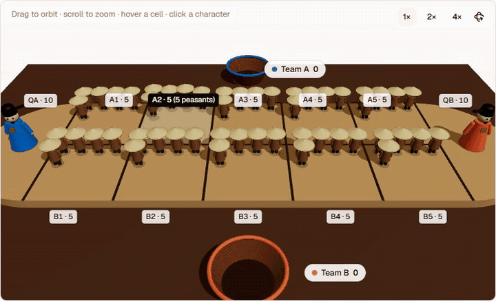
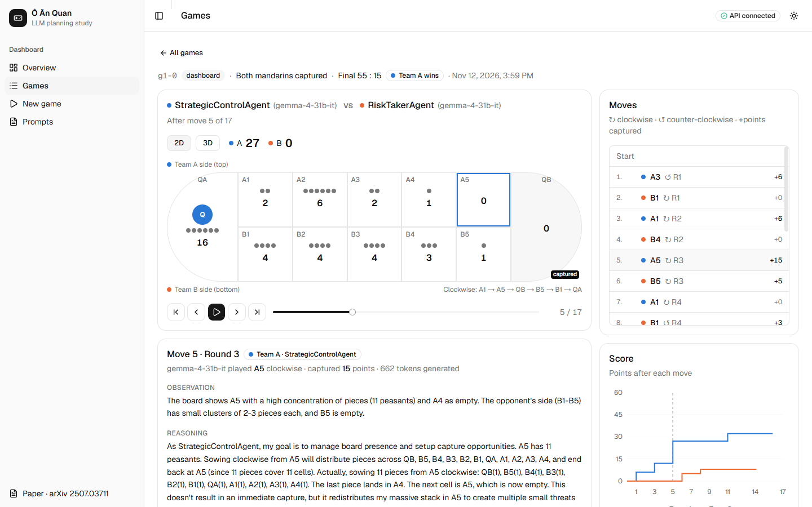
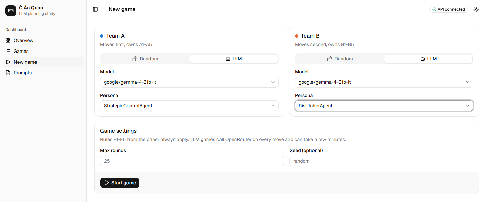

# Can LLMs Play Ô Ăn Quan? A Study of Multi-Step Planning and Decision Making

[](https://arxiv.org/abs/2507.03711)
[](https://ieeexplore.ieee.org/document/11133971/)

📄 Paper: [IEEE Xplore](https://ieeexplore.ieee.org/document/11133971/) · [arXiv](https://arxiv.org/abs/2507.03711)

This repository contains a reference implementation of the Ô Ăn Quan
game environment and LLM-based agents used in our study.

## Abstract

In this paper, we explore the ability of large language models (LLMs) to plan and make decisions through the lens of the traditional Vietnamese board game, Ô Ăn Quan. This game, which involves a series of strategic token movements and captures, offers a unique environment for evaluating the decision-making and strategic capabilities of LLMs. Specifically, we develop various agent personas, ranging from aggressive to defensive, and employ the Ô Ăn Quan game as a testbed for assessing LLM performance across different strategies. Through experimentation with models like Llama-3.2-3B-Instruct, Llama-3.1-8B-Instruct, and Llama-3.3-70B-Instruct, we aim to understand how these models execute strategic decision-making, plan moves, and manage dynamic game states. The results will offer insights into the strengths and weaknesses of LLMs in terms of reasoning and strategy, contributing to a deeper understanding of their general capabilities.



## Dashboard

A Next.js dashboard replays every game move by move, in **2D** or **3D**, and shows the
experiment results. In 3D, peasants (*dân*, with their conical *nón lá* hats) and the two
mandarins (*quan*, in team-coloured robes and winged *mũ cánh chuồn* hats) are built from
three.js primitives and act out each move. Below, two **Gemma 4 31B** agents
(`google/gemma-4-31b-it` via OpenRouter) play each other:

<p align="center">
  
</p>
<p align="center"><sub>Moves 5–6 (2× speed): StrategicControlAgent picks up 11 peasants, sows them all the way around the board and captures team B's mandarin (+15); RiskTakerAgent answers with a four-step sowing chain.</sub></p>

<p align="center">
  
</p>
<p align="center"><sub>Hover a cell and its peasants cheer; click a character and it jumps, spins and talks. Drag to orbit, scroll to zoom.</sub></p>

<table>
  <tr>
    <td width="50%"></td>
    <td width="50%"></td>
  </tr>
  <tr>
    <td align="center"><sub>2D replay of the same move with Gemma's reasoning. It expected no capture, yet the move takes the mandarin: multi-step sowing is hard to plan.</sub></td>
    <td align="center"><sub>Start a game with a random or LLM agent per team and watch it live</sub></td>
  </tr>
</table>

The game shown is a single Gemma 4 31B vs Gemma 4 31B game, not a result from the paper.
See [Dashboard](#dashboard-1) below to run it, and
[its JSON log](backend/logs/game-20261112-155953-StrategicControlAgent-vs-RiskTakerAgent.json) for every move.

## Project Structure

```
backend/
├── pyproject.toml
├── requirements.txt
├── logs/                        # Sample game logs
├── src/o_an_quan/
│   ├── __main__.py              # Demo: python -m o_an_quan
│   ├── config.py                # Model endpoints and experiment defaults
│   ├── utils.py                 # Logging and visualization utilities
│   ├── game/
│   │   ├── environment.py       # Board, rules (basic + E1-E5), state transitions
│   │   └── runner.py            # Game loop: 25 rounds, turn history (H), E2 restore, game records
│   ├── agents/
│   │   ├── base.py              # TurnResult and Player interface
│   │   ├── schemas.py           # Structured LLM outputs
│   │   ├── tools.py             # LangChain tools (observe / plan / act)
│   │   ├── llm_agent.py         # LLM agent: LLM(G, H, R, P) -> (reason, action)
│   │   └── random_agent.py      # RandomAgent baseline
│   ├── prompts/
│   │   ├── templates/*.md       # System prompt, rules (R), decision and classification prompts
│   │   └── personas/*.md        # Agent personas (P), one markdown file per persona
│   ├── experiments/             # Reproduction of Section V: python -m o_an_quan.experiments
│   │   ├── runners.py           # Persona vs RandomAgent, model vs model
│   │   ├── classify.py          # Reasoning-type classification
│   │   ├── reports.py           # Table I, Table II, Table III, planning depth
│   │   └── cli.py
│   └── api/                     # FastAPI server for the dashboard: python -m o_an_quan.api
└── tests/

frontend/                        # Next.js dashboard (Tailwind CSS + shadcn/ui)
└── src/
    ├── app/                     # Pages: overview, games, games/[id] replay, play, prompts
    ├── components/              # dashboard/ charts, game/ board + replay, play/ new-game form, ui/ shadcn
    └── lib/                     # API client, types, formatting
```

The agent follows Eq. (1) of the paper: `LLM(G, H, R, P) -> (reason, action)`, where
`G` is the board state, `H` the previous turn (both players' moves and reasoning),
`R` the rules and `P` the persona.

## Setup

```bash
python -m venv venv
venv\Scripts\activate          # Windows  (Linux / macOS: source venv/bin/activate)
pip install -r backend/requirements.txt
pip install -e backend
```

Then set up your OpenRouter API key and LangSmith API key in a `.env` file at the
repository root, following the format in [example.env](example.env).

## Usage

```bash
python -m o_an_quan                                              # LLM demo, 5 rounds
python -m o_an_quan --a random --b random --rounds 25 --seed 0   # no API calls
python -m o_an_quan --help                                       # agents, model, personas, seed, log dir
```

Each game is saved as a JSON log in `logs/` (`--log-dir` or `LOGS_DIR` to change it):
the setup (`config`), the result, and for every move the reasoning, the steps, the
board and score afterwards, and the pickup / drop / capture events.
Examples: [Gemma 4 31B vs Gemma 4 31B](backend/logs/game-20261112-155953-StrategicControlAgent-vs-RiskTakerAgent.json),
[random vs random](backend/logs/game-20261112-150231-RandomAgent-vs-RandomAgent.json)

### Experiments

```bash
# Table I: persona agents (Balanced, Defensive, QuickPlay, RiskTaker, StrategicControl) vs RandomAgent, 50 games each
python -m o_an_quan.experiments personas --model meta-llama/llama-3.3-70b-instruct

# Table II: Llama-3.2-3B / 3.1-8B / 3.3-70B vs Llama-3.3-70B, 50 games each
python -m o_an_quan.experiments models

# Table III: classify each move's reasoning (SHORT_TERM_GAIN / LONG_TERM_STRATEGY / AMBIGUOUS) with Gemini-2.0-Flash
python -m o_an_quan.experiments classify --input results/models.jsonl

# Print Table I, Table II and planning depth from saved games
python -m o_an_quan.experiments report --input results/personas.jsonl results/models.jsonl
```

Add `--verbose` before the sub-command to print every tool call and move.
Results are appended to `results/*.jsonl` in the current directory.
Planning depth is measured as the number of tokens the model generates per move.

### Dashboard

The dashboard shows experiment results (Tables I-III, planning depth), replays every
saved game move by move, and lets you start new games (random or LLM agents) and watch
them live. It reads the same `results/*.jsonl` files as the CLI.

```bash
# Terminal 1: API on http://127.0.0.1:8000 (run from the repository root)
python -m o_an_quan.api

# Terminal 2: dashboard on http://localhost:3000
cd frontend
npm install
npm run dev
```

The dashboard proxies `/api/*` to the API; set `BACKEND_URL` to point it elsewhere.
Games started from the dashboard are saved to `results/games.jsonl`.

### Tests

```bash
cd backend
python -m unittest discover -s tests
```

## Citation

If you use this code, please cite:

```
@inproceedings{nguyen2025can,
  title={Can LLMs Play {\^O} {\u{A}}n Quan? A Study of Multi-Step Planning and Decision Making},
  author={Nguyen, Sang Quang and Van Nguyen, Kiet and Nguyen, Vinh-Tiep and Ngo, Thanh Duc and Nguyen, Ngan Luu-Thuy and Le, Duy-Dinh},
  booktitle={2025 International Conference on Multimedia Analysis and Pattern Recognition (MAPR)},
  pages={1--6},
  year={2025},
  organization={IEEE}
}
```
